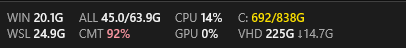
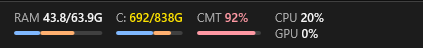
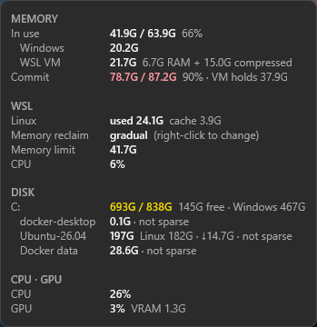

# StatsOverlay

**How much of your RAM and disk is Windows, and how much is WSL?**

StatsOverlay is a tiny readout that lives *inside* the Windows 11 taskbar and
splits memory and disk between Windows and the WSL 2 VM (including Docker
Desktop), so you can see at a glance when `VmmemWSL` is eating your machine.





Hover it for the full breakdown:



- **Small.** One ~0.5 MB portable `.exe`, ~3.5 MB of RAM, about 0% CPU at
  idle. Plain Win32 + Direct2D, no GUI framework, no runtime, no service.
- **Embedded.** A layered child window of the taskbar, so it moves, hides and
  auto-hides with it. It falls back to a small always-on-top strip if embedding
  fails.
- **Honest WSL numbers.** It counts the VM's memory that Windows has compressed,
  which Task Manager's `VmmemWSL` row leaves out (see below).
- **Never wakes WSL.** It only calls `wsl.exe` while the VM is already running,
  and polls inside distros rarely enough that it never keeps an idle distro alive.

## What it shows

| | |
| --- | --- |
| **WIN / WSL** | RAM used by Windows vs. the WSL VM. They add up to **ALL** (Task Manager's "In use"). |
| **CMT** | Commit charge: committed / commit limit. Running out of commit, not RAM, is what makes allocations fail, and the VM can push it high. |
| **CPU / GPU** | Task Manager-style CPU utilization and busiest GPU engine (+ dedicated VRAM in the panel). |
| **C:** | Drive used / total. In the panel, "Windows" is what's left after subtracting WSL's virtual disks. |
| **VHD** | Space taken on disk by every WSL 2 distro's `ext4.vhdx` and Docker Desktop's data disk. **↓** is space Linux has freed inside them that the file still holds (reclaimable by compacting, or automatically with sparse disks). |

Values turn yellow at 80% and red at 90%.

### Why the WSL figure is bigger than Task Manager's VmmemWSL

Windows compresses the VM's idle memory and moves it into the *Memory
Compression* process, so `VmmemWSL`'s working set alone undercounts WSL. On a
64 GB machine we saw 10 GB resident plus 15 GB compressed. StatsOverlay counts:

```
WSL = VM working set + min(compression store, VM private − VM working set)
WIN = in use − WSL
```

Per-process figures come from `NtQuerySystemInformation`, the same source Task
Manager uses.

## Layouts and settings

Right-click the strip:

- **Display**: pick the layout and toggle CPU, GPU, commit and disk.
  - *Grid*: two lines per metric (shown above).
  - *Windows / WSL rows*: one row each, with RAM, disk and CPU side by side.
  - *Bars*: one column per resource, with a bar split Windows (blue) / WSL (orange).
  - *Compact*: just WIN and WSL memory.
- **WSL settings**: edits `%USERPROFILE%\.wslconfig` in place (other lines and
  comments are kept; the original is backed up once to
  `.wslconfig.statsoverlay-backup`):
  - `autoMemoryReclaim`: gradual / dropCache / disabled / not set
  - VM memory limit (`[wsl2] memory`): default, presets, or a custom value
  - It offers to restart WSL so the change applies.
  - Open `.wslconfig` in Notepad, or the WSL Settings app when it's installed.
- **Reclaim WSL cache**: drops Linux's page cache, so the VM can hand memory back.
- **Shut down WSL…**: `wsl --shutdown`, after asking.
- **Start with Windows**, **Open Task Manager**, **Exit**.

Left-click opens Task Manager. Display settings are stored under
`HKCU\Software\StatsOverlay`.

## Install

Download `statsoverlay.exe` from Releases and run it. To start it with
Windows, use right-click > Start with Windows. To remove it: untick that,
Exit, and delete the exe (and optionally `HKCU\Software\StatsOverlay`).

### Build from source

Rust with the MSVC toolchain (the default on Windows) and the Visual Studio
Build Tools (C++ workload):

```
cargo build --release
```

Output: `target\release\statsoverlay.exe`. Cross-compiling with
`--target x86_64-pc-windows-gnu` also works (needs MinGW's `windres`).

### Command line

| Option | |
| --- | --- |
| `--popup` | Use the always-on-top strip instead of embedding in the taskbar. |
| `--offset N` | Left offset in logical px (default: after the Widgets button). |
| `--diag` | Write `statsoverlay-diag.txt` (taskbar layout, memory accounting, distros, disks, `.wslconfig`) and open it. |

## Compatibility

- Windows 11 taskbar, centered or left-aligned icons. Light and dark themes,
  any DPI.
- A taskbar moved to the top (ExplorerPatcher, StartAllBack) works; the panel
  and menu open downwards.
- Only the main monitor's taskbar for now. Vertical (left/right) taskbars
  aren't supported yet.
- WSL 2 (WSL 1 distros have no VM or virtual disk). Docker Desktop's WSL
  backend is detected.

## How it compares

Similar tools exist, but none we found combine these:

- [TrafficMonitor](https://github.com/zhongyang219/TrafficMonitor): mature,
  taskbar-embedded CPU/RAM/network monitor, but no WSL view.
- [wsl-tray](https://github.com/thewerthon/wsl-tray) and its forks: a tray icon
  with WSL on/off, CPU and memory, and shutdown.
- [wsl-dashboard](https://github.com/owu/wsl-dashboard): a GUI for managing WSL
  distros.
- [wsl2compact](https://www.powershellgallery.com/packages/wsl2compact) and
  [wsldisk](https://github.com/wslkit/wsldisk): scripts for compacting WSL
  virtual disks.

StatsOverlay sits in the taskbar like TrafficMonitor, but it's about the
Windows vs. WSL split: compressed VM memory, commit, and virtual disk space.

## Source layout

| File | Role |
| --- | --- |
| `src/main.rs` | Windows, message loop, placement, menus |
| `src/sampler.rs` | Sampler thread: memory, VM and compression accounting, WSL and disk polling |
| `src/procs.rs` | Per-process memory and CPU via `NtQuerySystemInformation` |
| `src/metrics.rs` | CPU (system times × clock), GPU and VRAM (`D3DKMTQueryStatistics`), commit charge |
| `src/disk.rs` | Drives and WSL/Docker VHDX sizes |
| `src/wsl.rs` | `wsl.exe` calls, only while the VM and a distro are already running |
| `src/wslconfig.rs` | Reading and editing `.wslconfig` |
| `src/config.rs` | Display settings in the registry |
| `src/prompt.rs` | The custom memory limit dialog (in-memory dialog template) |
| `src/render.rs` | Direct2D/DirectWrite into a premultiplied DIB, `UpdateLayeredWindow` |
| `src/taskbar.rs` | Finding the taskbar, alignment, Widgets button, top/bottom |
| `src/theme.rs` | Light/dark, colors |
| `src/startup.rs` | Start with Windows (HKCU Run key) |
| `src/diag.rs` | `--diag` report |
| `build.rs`, `app.manifest`, `app.rc` | Embeds the manifest (DPI awareness, Windows 10/11 compatibility) |

Test checklists per milestone are in `docs/`.
